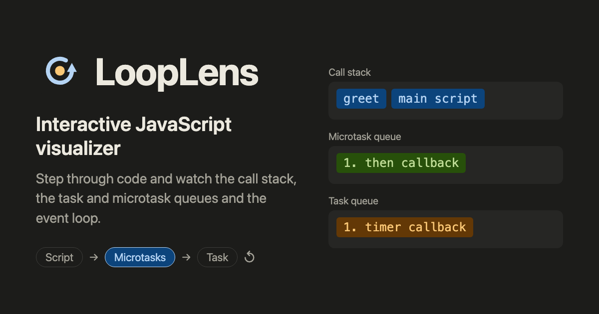

# LoopLens: see how JavaScript really runs

[](https://looplens.pages.dev/)

**▶ Try it live: [looplens.pages.dev](https://looplens.pages.dev/)**

LoopLens is a free, open-source, interactive JavaScript visualizer. Paste code (or pick one of 21 examples) and step
through it line by line, while you watch the **call stack**, **Web APIs**, the **microtask queue**, the **task queue**,
the **event loop**, **scope and closures** and the **console** change at every step.

It answers the questions that are hard to see by just running code: _why does a promise run before `setTimeout(…, 0)`?_
_Where does a callback wait?_ _What does `await` actually pause?_

## Features

- **Step-by-step replay**: Next, Back, Play (with speed control) and a timeline you can jump through, also with the keyboard.
- **Every part of the runtime on one screen**: current line, call stack, Web APIs, both queues, console output, and
  variables (changed values highlighted).
- **Predict mode**: before a step prints, LoopLens asks "What will it print?" so you can test yourself.
- **21 built-in examples**: basics, timers, promises and microtasks, async/await, and error handling.
- **Share links**: "Copy link" puts your code in the URL fragment (`#code=…`), so it never reaches a server.
- **Accessible**: keyboard-operable timeline, screen-reader announcements, visible focus, light and dark themes,
  and reduced-motion support.

## Learn the concepts

Each guide explains one topic in plain language, with code you can step through in the built-in visualizer:

| Guide                                                                                   | What you'll learn                                                     |
| --------------------------------------------------------------------------------------- | --------------------------------------------------------------------- |
| [JavaScript execution context](https://looplens.pages.dev/javascript-execution-context) | Creation vs execution phase, hoisting, the temporal dead zone, `this` |
| [How the call stack works](https://looplens.pages.dev/javascript-call-stack)            | Stack frames, recursion, "Maximum call stack size exceeded"           |
| [How the event loop works](https://looplens.pages.dev/javascript-event-loop)            | Script → microtasks → one task, why `setTimeout(fn, 0)` isn't instant |
| [Microtasks vs macrotasks](https://looplens.pages.dev/javascript-microtasks-macrotasks) | Which callbacks go to which queue, and in what order they run         |
| [How promises work](https://looplens.pages.dev/javascript-promises)                     | States, chaining, `catch`, `finally`, `Promise.all` vs `race`         |
| [JavaScript closures](https://looplens.pages.dev/javascript-closures)                   | Lexical scope, private state, the `var` vs `let` loop bug             |

## How it works

```
your code ──acorn──► syntax tree ──interpreter──► Step[] (a snapshot after every action) ──► React UI replays steps[i]
```

- **Engine** (`src/engine/`, no UI code): [Acorn](https://github.com/acornjs/acorn) parses the code, and a
  generator-based interpreter runs it, with its own promise implementation that follows the ECMAScript job rules. It
  records a snapshot after every step. Time is virtual: when nothing else can run, the clock jumps to the next timer.
- **Checked against real JavaScript**: every example also runs in Node.js, and the tests fail if LoopLens's console
  output differs in any way, including order.
- **Fast pages**: every page is prerendered to static HTML at build time, and the example's steps are precomputed.
  The parser and interpreter load only when you run new code.

**Real vs simulated:** parsing, scope, closures, `this` and the order of promises, `await` and timers are real. The call
stack, Web APIs, queues, event loop and clock are a simulation of what a browser does. Not supported yet: `var`
hoisting, generators, `switch`, regular expressions, modules and a few other features (the full list is in
[DOCUMENTATION.md](DOCUMENTATION.md#what-code-it-can-run)).

## Tech stack

React 18 · TypeScript (strict) · Vite · Acorn · Vitest · build-time prerendering with `react-dom/server` · Cloudflare Pages

## Run it locally

Requires Node.js 22 (see `.nvmrc`).

```bash
npm ci
npm run dev        # start the app at http://localhost:5173
npm test           # run all tests
npm run build      # typecheck, build and prerender every page into dist/
```

More detail: [DOCUMENTATION.md](DOCUMENTATION.md) (how the engine works, project structure, adding pages and examples)
and [DEPLOYMENT.md](DEPLOYMENT.md) (hosting on Cloudflare Pages).

## Contributing

Bug reports and ideas are welcome: open an issue with the code that behaved unexpectedly, and what real JavaScript
printed.

## License

[MIT](LICENSE) © Rajesh Chouhan
